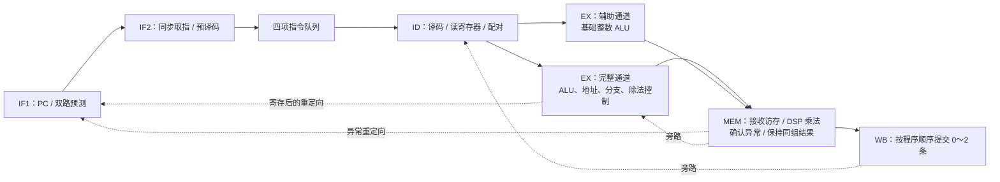

# 青龙 QingLong CPU 设计说明

本工程是面向紫光同创赛题一的自主 SystemVerilog CPU 与最小 SoC。处理器采用 IF1、IF2、ID、EX、MEM、WB 六级顺序流水线，支持双发射、动态执行通道分配、分支预测和机器态异常中断。性能与资源的实际结果见 [性能与验证报告](性能与验证报告.md)，PDS 操作见 [PDS 使用说明](PDS使用说明.md)。

## 1. 已实现范围

| 项目 | 实现 |
| --- | --- |
| 指令集 | RV32I、M、Zicsr、Zifencei、Zba、Zbb；32 位固定指令，小端 |
| 特权 | M-mode，Direct/Vectored 中断，精确同步异常 |
| 流水线 | 六级，顺序发射与提交，最多两条/周期 |
| 执行单元 | 一路完整整数单元，一路基础整数 ALU，DSP 乘法，迭代除法 |
| 前端 | 每次最多取两条，四项指令队列，跨取指块配对，七位预译码信息 |
| 预测 | 默认 256 项带标签 BTB，三位局部历史，每项八个两位方向计数器，16 项返回地址栈 |
| 数据通路 | 两个单写口寄存器存储体，最近写入标记，两路 MEM/WB 旁路 |
| 片上存储 | 64 KiB 统一 TCM；指令和数据接口分离；无 Cache/DDR |
| 外设 | UART TX、GPIO、64 位定时器、软件中断、仿真退出寄存器 |
| 复位入口 | 默认 0x00000000 |

没有使用第三方 CPU IP。GCC、CoreMark、riscv-tests 和仿真工具是构建与验证依赖，并非 CPU 实现。尚未实现 C/A/F/D/V 扩展、S/U-mode、PMP/MMU、操作系统、AI 加速器、键盘、HDMI、UART RX 和持久化存储。

Zba 提供 SH1ADD/SH2ADD/SH3ADD。Zbb 提供逻辑取反组合、计数、旋转、最小/最大值、符号扩展、字节反转等操作。没有 Zbs，因此不将其标成完整 B 扩展；misa 仍报告 I+M。软件可使用：

```text
-march=rv32im_zicsr_zifencei_zba_zbb -mabi=ilp32
```

## 2. 流水线和存储时序



IF1 保存请求地址及两条指令的预测 PC；IF2 接收响应并计算配对需要的少量属性。队列保存 PC、指令、预测、错误和预译码信息，出队一或两条后压紧。预译码避免把完整译码器、配对判断与大范围队列移动串在同一关键路径上。

EX 中独立的地址加法器产生访存地址，不经过复杂 ALU 结果选择。默认 EARLY_LSU=1：请求在 EX 被接受，MEM 接收同步 RAM 响应。上一条响应完成时可以同时接受下一条请求，但每个接口始终至多一个未完成事务。外部等待会保持流水线和操作数。EARLY_LSU=0 保留为较保守的 MEM 发起模式。

六级是逻辑阶段划分；迭代除法、总线等待、依赖和分支纠正会停顿。分支重定向额外寄存用于缩短路径，不意味着每条指令固定六周期完成。

## 3. 双发射规则

完整通道支持所有实现的指令；辅助通道只支持基础 RV32I 算术、逻辑、移位、比较、LUI/AUIPC，不包含 Zba/Zbb、访存、乘除、控制流或系统指令。

物理通道可交换：

| 程序顺序 | 物理分配 |
| --- | --- |
| 较老非控制流指令 + 较年轻基础 ALU | 较老进入完整通道，较年轻进入辅助通道 |
| 较老基础 ALU + 较年轻访存/乘除/分支/跳转/其他非串行指令 | 较老进入辅助通道，较年轻进入完整通道 |

同组 RAW、WAW 冲突、已知取指错误、非法编码、系统串行化或不符合预测控制流条件时，退回单发射。第二条继续保存在队列，允许与后续取指块中的相邻指令配对。WAR 可以配对，x0 不产生写依赖。没有跨过指令找更远候选的重排，也没有寄存器重命名或乱序执行。

```asm
lw   t0, 0(a0)
addi t1, a1, 1      # 独立，可以配对

addi t2, t2, 1
sw   a2, 0(a3)     # 独立，可以交换通道后配对

addi t0, zero, 17
addi t1, t0, 6      # RAW，分开发射
```

两条提交信号始终按程序顺序排列，不按物理执行通道排列。若交换通道后较年轻的完整通道发生异常，较老辅助 ALU 仍正常提交，mepc 指向较年轻的故障指令；若较老指令故障，则同组较年轻指令不提交。19 组双发射专项覆盖这些区别。

## 4. 寄存器、旁路和运算单元

寄存器文件由两个各 32×32 位的单写口存储体构成，每个架构寄存器用一位记录最近写入的存储体。两个提交端口各写自己的存储体，综合器可按读取端口复制 LUT RAM。相比双写口触发器阵列，这种实现显著减少 LUT 和触发器。x1～x31 不复位清零，启动软件初始化 sp/gp；x0 恒为零。

MEM 与 WB 的两条结果都能旁路到 EX，读取阶段也包含 WB 旁路。优先选择较新的结果；停顿时寄存已取得的旁路值，避免生产者离开 WB 后丢失操作数。LOAD_BYPASS=1 允许成功的 MEM Load 响应直接旁路 EX；关闭后等待 WB，增加停顿但缩短数据路径。

乘法拆成四个不超过 17×17 位的独立部分积，避免四个 DSP 串接。EX 寄存操作数，普通 MUL 在 MEM 合成低 32 位；MULH/MULHSU/MULHU 多用一个 MEM 周期寄存部分积，再合成高位。消费者等待 WB，避免把乘法与下一条 EX 运算串联。除法使用 32 次 radix-2 迭代；有负操作数的有符号除法增加一个绝对值准备周期，切断 Load 旁路到取负加法器的路径。除零和有符号溢出也走迭代通路，结束时修正除零的商，避免输入操作数的宽比较控制寄存器使能；更老异常可取消除法。

ALU 使用独立的左移和右移通路，消除共享移位器输入、输出两侧的位反转选择；完整通道在移位通路内支持旋转，另有分级前导零检测和树形人口计数。辅助 ALU 关闭扩展操作以控制面积。

## 5. 分支预测和精确控制流

BTB 保存标签、目标、条件分支和返回类型。局部历史记录同一表项最近三次条件分支结果，选择八个两位饱和计数器之一；表项首次分配会初始化历史和计数器。标签未命中预测顺序执行。LOCAL_HISTORY=0 可在预测器模块内切回单个两位计数器。

16 项 RAS 识别写 x1/x5 的调用，以及 rd=x0、rs1=x1/x5、imm=0 的 JALR 返回。EX 的已确认分支结果先寄存，再更新 BTB、局部历史和 RAS，切断旁路、条件比较和预测器写入之间的长路径。因为没有推测更新，不需要回滚 RAS；非常短的调用链可能预测不准，由 EX 正常纠正。溢出保留最近 16 项。

EX 对比真实下一 PC 和保存的预测 PC。重定向寄存后驱动前端；决策当周期新接受的旧路径取指会被标为 killed，已有请求的返回响应也会排空丢弃。FENCE.I 同时清除预测有效位和 RAS。

## 6. 异常、中断与 CSR

| 异常码 | 含义 |
| --- | --- |
| 0 / 1 / 2 | 指令地址不对齐 / 取指访问错误 / 非法指令或 CSR |
| 3 | EBREAK |
| 4 / 5 | Load 地址不对齐 / 总线错误 |
| 6 / 7 | Store 地址不对齐 / 总线错误 |
| 11 | M-mode ECALL |

半字和字的非对齐访存产生精确异常，不自动拆成多次访问。更老的访存错误会抑制年轻指令的请求，防止错误路径上的 Store 副作用。第二个取指字独立保存错误；从 0xFFFC 开始取指不会因第二个字越界而错误撤销第一条。

中断优先级为外部 MEI(11) > 软件 MSI(3) > 定时 MTI(7)。输入必须已同步到 CPU 时钟。中断挂起后停止新的发射，排空较老执行组，在未执行的下一条指令边界进入异常。

实现 mstatus、misa、mie/mip、mtvec、mscratch、mepc、mcause、mtval、mcountinhibit、mcycle/minstret 及 RV32 高半部、只读计数器别名和机器身份 CSR。mtvec 支持 Direct/Vectored；MRET 恢复 MIE/MPIE。CSR/FENCE/MRET 等按规则串行化；WFI 是串行 NOP。未实现 CSR 或写只读 CSR 会异常。

mcycle 是 64 位周期计数；minstret 按真实提交每周期增加 0、1 或 2。RTL 提供两条退休接口、trap、分支数、误预测数、Load 停顿数、第二条退休数。板级顶层没有连接的调试输出可能被综合裁剪；接入 ILA 时应重新统计资源并验证时序。

## 7. 总线与最小 SoC

取指请求起始地址按四字节对齐，响应低/高 32 位分别是 PC/PC+4 的指令，错误位分别对应两条。数据请求为字对齐地址、32 位写数据和四位字节选通；Load 的位移和扩展在 CPU 内完成。

两个接口均为 valid/ready，请求被接受后至少下一周期响应。响应必须保持到握手；每个接口最多一个未完成事务。数据请求等待时保持地址和写数据。取指请求在接受前可因重定向取消，因此不能直接当作 AXI 接口使用；接 AXI/DDR 时需要协议适配。

| 地址 | 功能 |
| --- | --- |
| 0x00000000～0x0000FFFF | 64 KiB 程序/数据 TCM |
| 0x10000000 | UART TX 写数据；读 bit 0 为发送器 ready |
| 0x10000004 | 32 位退出码 / done |
| 0x10000008 | GPIO |
| 0x10000100 / 104 | mtime 低/高 32 位 |
| 0x10000108 / 10C | mtimecmp 低/高 32 位 |
| 0x10000110 | 软件中断 bit 0 |

物理 UART 写请求先寄存，发送器接受后才返回总线响应。这样背压不需要通过组合地址译码返回 CPU；不轮询 ready 的连续写入也不会丢字节。SIM_FAST_UART=1 只用于加快仿真日志，性能计时区间不含 UART 打印。SoC 级测试用真实 27 MHz/115200 波特率核对六种字节、全部串行位宽与交错 RAM 访问。

TCM 没有 Cache 一致性问题，但多读口会导致综合器复制 RAM，64 KiB 逻辑容量使用 48 个 DRM36K。软件修改代码后执行 FENCE.I。OS 与 AI 加速器可从现有 M-mode 中断和 MMIO 接口接入；后续 DMA、外部存储和 Cache 需补充仲裁、一致性及错误处理。

## 8. 构建、验证与板级边界

执行 make check 包含启动、70 项上游指令测试、15 类异常/CSR、机器态中断、19 组双发射、219 轮随机总线差分、UART 单元及 SoC 串行波形测试。差分模型独立计算整数/位操作结果；CSR 返回值在差分模型中透传，其行为由定向测试覆盖。该回归不是完整架构认证或形式验证。

PDS 使用单一合并编译单元，规避旧版 ADS 的 package、枚举和结构体端口兼容限制。原始模块仍在 rtl/ 独立维护；修改后运行 scripts/sync_pds_project.ps1。

实板使用 `fpga/board/qinglong_board_system.sv`，通过 GPLL 将 D18 的 27 MHz 时钟倍频；KEY0 复位 CPU，PLL 失锁也使 CPU 保持复位。`scripts/prepare_board.ps1` 生成包含 PLL、已核对引脚、固件和哈希记录的独立工程，`scripts/program_board.ps1` 执行配置 RAM 下载、UART 采集和后续配置校验。根目录 `RiscV.pds` 仍用于无板级引脚约束的时序探索，不能直接替代实板工程。最高已验证板级配置、CoreMark/MHz、CoreMark/LUT、时序及编译条件统一记录于上板调试记录和性能报告。
